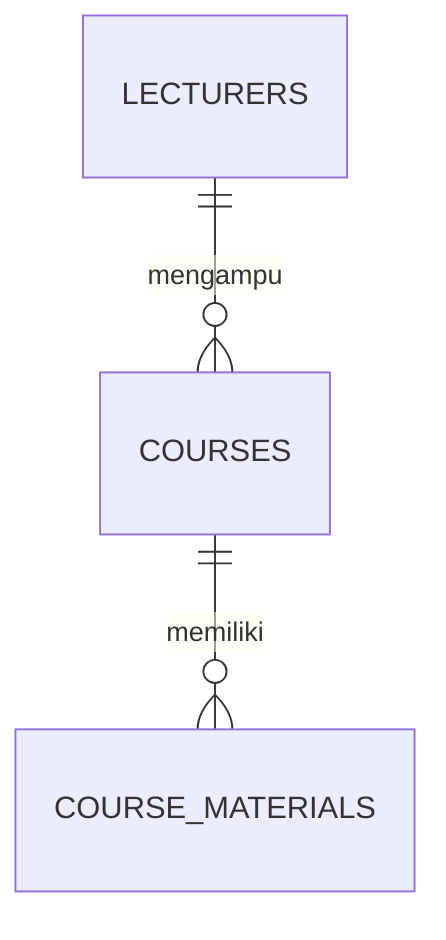

# Janji
Saya Afit Fajar Rianto dengan NIM 2501826 mengerjakan Tugas Praktikum 8 dalam mata kuliah Desain dan Pemrograman Berorientasi Objek (DPBO) untuk keberkahan-Nya, maka saya tidak melakukan kecurangan seperti yang telah dispesifikasikan. Aamiin.

---

# Sistem Akademik MVC

Project PHP dan MySQL ini mengelola dosen, mata kuliah, dan materi mata kuliah dengan arsitektur MVC. Semua tabel memiliki fitur CRUD: tambah, lihat, ubah, dan hapus.

---
## Desain program

Program dibagi menjadi beberapa bagian agar query database, alur request, dan HTML tidak bercampur:

```text
tp_mvc25/
├── assets/vendor/       # Bootstrap CSS/JavaScript dan library vendor
├── config.php           # Kredensial database dan helper escape HTML
├── controllers/         # Controller Lecturer, Course, CourseMaterial
├── database/
│   └── tp_mvc25.sql     # Dump phpMyAdmin berisi struktur tabel dan data
├── models/              # Model data dan koneksi dasar DB
├── templates/           # Kerangka halaman HTML
├── views/               # Class view dan Template.php
├── index.php            # Front controller/router
└── README.md
```

---
### Tanggung jawab tiap bagian

- `config.php` menyimpan host, user, password, dan nama database. Helper `e()` meng-escape nilai dinamis sebelum dicetak ke HTML.
- `models/DB.php` membuka/menutup koneksi MySQL dan menyediakan pembacaan hasil query. `Lecturer.php`, `Course.php`, dan `CourseMaterial.php` berisi query per entitas.
- `controllers/` memvalidasi input dan ID, mengatur koneksi, memilih method model, lalu mengirim data ke view.
- `views/` membentuk baris tabel dan opsi dropdown. `Template.php` membaca file dari folder `templates/` dan mengganti token seperti `{{MATERIAL_ROWS}}`.
- `templates/` berisi halaman daftar dan form. Form hapus menggunakan `POST`; aksi tambah/edit juga mengirim data melalui `POST`.
- `index.php` menjadi satu pintu masuk untuk semua halaman dan aksi.

---
## Alur aplikasi

1. Pengguna membuka `index.php`; router membaca `$_GET['page']`. Tanpa parameter, halaman daftar dosen ditampilkan.
2. Pengguna memilih aksi dari navigasi/tombol. Router memeriksa route dan tombol submit pada `$_POST`, kemudian memanggil controller yang sesuai.
3. Controller membaca dan memvalidasi input. Method `edit()` mengambil ID dari `$_GET['id']`, sedangkan method `delete()` mengambil ID dari `$_POST['id']`.
4. Controller meminta model menjalankan query. Query tulis menggunakan prepared statement.
5. Untuk halaman daftar atau form, controller meneruskan data ke class view. View mengisi token template dan menghasilkan HTML.
6. Setelah penyimpanan atau penghapusan berhasil, aplikasi mengarahkan pengguna kembali ke halaman daftar. ID yang tidak valid juga diarahkan kembali ke halaman terkait.

---
## Fitur

| Bagian | Data yang dapat dikelola | Relasi/penggunaan |
|---|---|---|
| Dosen | Nama, NIDN, telepon, tanggal bergabung | NIDN unik; menjadi dosen pengampu mata kuliah |
| Mata kuliah | Kode, nama, SKS, dosen pengampu | Kode unik; dropdown dosen mengisi relasi ke dosen |
| Materi | Mata kuliah, judul, deskripsi, tautan opsional | Dropdown memilih mata kuliah; tautan disimpan melalui form, tetapi tidak ditampilkan sebagai kolom daftar |

Daftar menggunakan nomor urut, bukan ID database. ID tetap digunakan secara internal untuk aksi edit dan hapus. Jika dosen masih mengampu mata kuliah, database menolak penghapusan dosen dan aplikasi menampilkan pesan. Jika mata kuliah dihapus, materi yang berelasi ikut terhapus.

---
## Desain database dan relasi

Database `tp_mvc25` terdiri dari tiga tabel:

| Tabel | Kolom | Keterangan |
|---|---|---|
| `lecturers` | `id` (PK), `name`, `nidn` (unik), `phone`, `join_date` | Tabel data dosen dari project awal. |
| `courses` | `id` (PK), `code` (unik), `name`, `credits`, `lecturer_id` (FK) | `credits` dibatasi 1–6; `lecturer_id` menunjuk ke dosen pengampu. |
| `course_materials` | `id` (PK), `course_id` (FK), `title`, `description`, `resource_url` | Judul unik dalam satu mata kuliah; URL boleh kosong. |



Relasi `lecturers` ke `courses` adalah one-to-many: satu dosen dapat mengampu beberapa mata kuliah, tetapi satu mata kuliah merujuk ke satu dosen. Relasi `courses` ke `course_materials` juga one-to-many: satu mata kuliah dapat memiliki beberapa materi, dan setiap materi merujuk ke satu mata kuliah. Foreign key dosen menggunakan `ON DELETE RESTRICT`; foreign key materi menggunakan `ON DELETE CASCADE`.

---

# Database

File database project berada di folder `database/`:

- [`database/tp_mvc25.sql`](database/tp_mvc25.sql) adalah dump phpMyAdmin yang berisi struktur tiga tabel (`lecturers`, `courses`, dan `course_materials`), indeks, relasi foreign key, serta data contoh.

Struktur utama database:

```sql
CREATE TABLE lecturers (
    id INT AUTO_INCREMENT PRIMARY KEY,
    name VARCHAR(100) NOT NULL,
    nidn VARCHAR(20) NOT NULL UNIQUE,
    phone VARCHAR(20) NOT NULL,
    join_date DATE NOT NULL
);

CREATE TABLE courses (
    id INT AUTO_INCREMENT PRIMARY KEY,
    code VARCHAR(20) NOT NULL UNIQUE,
    name VARCHAR(120) NOT NULL,
    credits TINYINT UNSIGNED NOT NULL DEFAULT 3,
    lecturer_id INT NOT NULL,
    FOREIGN KEY (lecturer_id) REFERENCES lecturers(id)
        ON UPDATE CASCADE ON DELETE RESTRICT
);

CREATE TABLE course_materials (
    id INT AUTO_INCREMENT PRIMARY KEY,
    course_id INT NOT NULL,
    title VARCHAR(150) NOT NULL,
    description TEXT NOT NULL,
    resource_url VARCHAR(255) NOT NULL DEFAULT '',
    UNIQUE (course_id, title),
    FOREIGN KEY (course_id) REFERENCES courses(id)
        ON UPDATE CASCADE ON DELETE CASCADE
);
```

Untuk mengimpor database, buat atau pilih database bernama `tp_mvc25` di phpMyAdmin, buka tab **Import**, pilih `database/tp_mvc25.sql`, lalu klik **Import/Go**. File ini sudah berisi struktur dan data contoh, jadi tidak perlu seeder terpisah. Jika database sudah memiliki tabel dengan nama yang sama, gunakan database pengujian baru atau kosongkan tabel terlebih dahulu agar tidak terjadi konflik.

---
# Dokumentasi

- [Video dokumentasi](Dokumentasi/TP8DPBO2526C2.mp4)


https://github.com/user-attachments/assets/ec881045-ecc9-436d-9971-71753d3f13f7


